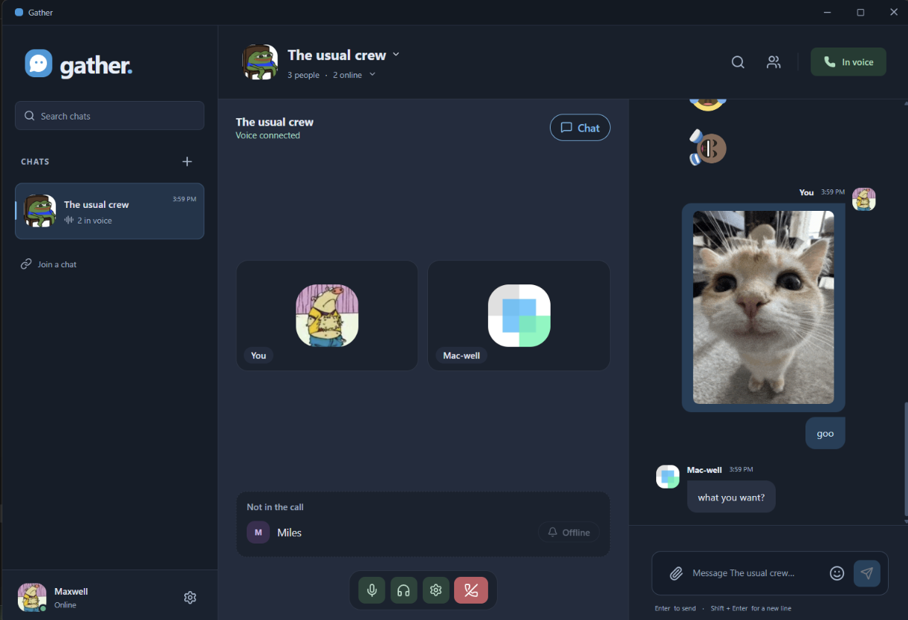

<p align="center"></p>

# Gather

 



**The always-there hangout for your small crew.** Gather is a free, open-source chat and voice app with the feel of old Skype, MSN and AIM: one link, your friends are in, you hear when they show up, and calling feels like it used to. No account, email or phone number. Pick a name and go.

[**Open Gather in your browser**](https://gather-friends.max-jacob-hastings.workers.dev/) · [Windows installer](https://gather-friends.max-jacob-hastings.workers.dev/download/windows)

## What you get

- **Group chat** that stays put: history, search, unread markers and counts, replies, edits, reactions, @mentions, "Seen by", typing indicators, link formatting, and muting for a while or Do Not Disturb.
- **Presence**: online, away after a few idle minutes, and a short status message. The desktop app stays in the tray when you close the window.
- **Voice calls for up to four people**, with mute/deafen, device selection and speaking rings. Ring a friend, or everyone who is online, and they get an incoming-call popup with Join and Decline.
- **A call stage** that shows everyone as tiles with chat beside it (a tab on narrow windows).
- **GIFs and emoji**: GIF search (powered by Klipy), a fast searchable emoji picker, and the classic MSN emoticons.
- **Photos, video, audio and files** up to 10 MB each, four per message, with inline previews.
- **Sounds** for messages and calls: four synthesized sound packs, or your own files.
- **Phone-friendly web app** that installs to your home screen, plus a Windows desktop app that updates itself.
- **Light, dark or system theme**, notifications you control, and export of your history.

## Try it with friends

1. Open Gather and enter a name.
2. Open chat details and copy the invite link.
3. Your friend opens the link, enters a name and joins.
4. Click **Join voice** and allow the microphone.

Chrome and Edge are the tested browsers; Safari has basic support. Windows has a per-user installer. macOS and Linux can use the browser today.

The chat owner can remove people, replace the invite or hand over ownership, and anyone can leave.

## How your data is handled

Gather's server is a short-lived relay, not an archive. Uploaded files are removed a day after every other member has downloaded them, and otherwise after 30 days (7 days for files of 25 MB or more). Text messages are kept for at least two years. Your devices keep their own copies, so export anything you want to keep long term. The server can read messages, so chat is not end-to-end encrypted. Voice is encrypted in transit by WebRTC and calls are never recorded.

Each chat and each person has a 250 MB limit; when it is reached the oldest files roll off instead of blocking new uploads.

The hosted service has [Terms](https://gather-friends.max-jacob-hastings.workers.dev/terms) and a [Privacy page](https://gather-friends.max-jacob-hastings.workers.dev/privacy). Anyone can report abuse without an account at [/report](https://gather-friends.max-jacob-hastings.workers.dev/report), or use the Report button on a message.

## Run your own

Gather runs on Cloudflare (a Worker, one SQLite Durable Object and an R2 bucket) or as a plain Node server with SQLite and local file storage.

```sh
git clone https://github.com/MaxHastings/gather.git gather
cd gather
npm ci
npm run dev        # starts the app against a local Node/SQLite backend
```

Requires Node 24+. To host on Cloudflare, copy `.env.example` to `.env`, fill in the optional TURN and Klipy keys, then:

```sh
npm run cloud:login
npm run cloud:secrets
npm run cloud:deploy
```

Voice uses WebRTC with temporary TURN credentials for hard networks; no media server or SDK is needed. GIF search needs a free [Klipy](https://klipy.com) key (`KLIPY_API_KEY`); without one the GIF tab is hidden.

## Development

```sh
npm run build          # type-check and bundle
npm test               # unit and server contract tests
npm run test:browser   # browser smoke tests
npm run dist           # Windows installer and portable build
npm run test:release   # the full release suite
```

Design and operations notes: [ARCHITECTURE.md](ARCHITECTURE.md), [PRODUCT.md](PRODUCT.md), [OPERATIONS.md](OPERATIONS.md), [RELEASE.md](RELEASE.md) and [CHANGELOG.md](CHANGELOG.md).

## Community and contributing

Questions, bug reports and hello's are welcome in the [Gather Discord](https://discord.gg/J8e4kvndyu). Issues and pull requests are welcome too. Gather is a small project run by one maintainer, so please keep changes focused and run `npm test` first.

## License and credits

Gather's source code is released under the [GNU AGPL-3.0](LICENSE). Bundled third-party artwork is **not** covered by it: emoji art is EmojiTwo (CC BY 4.0) and the classic MSN emoticons are Microsoft artwork redistributed from a community collection without an explicit license. See [licenses/NOTICE.md](licenses/NOTICE.md). Gather is an independent project and is not affiliated with or endorsed by Microsoft, Skype or Discord.

Report security issues privately as described in [SECURITY.md](SECURITY.md).
