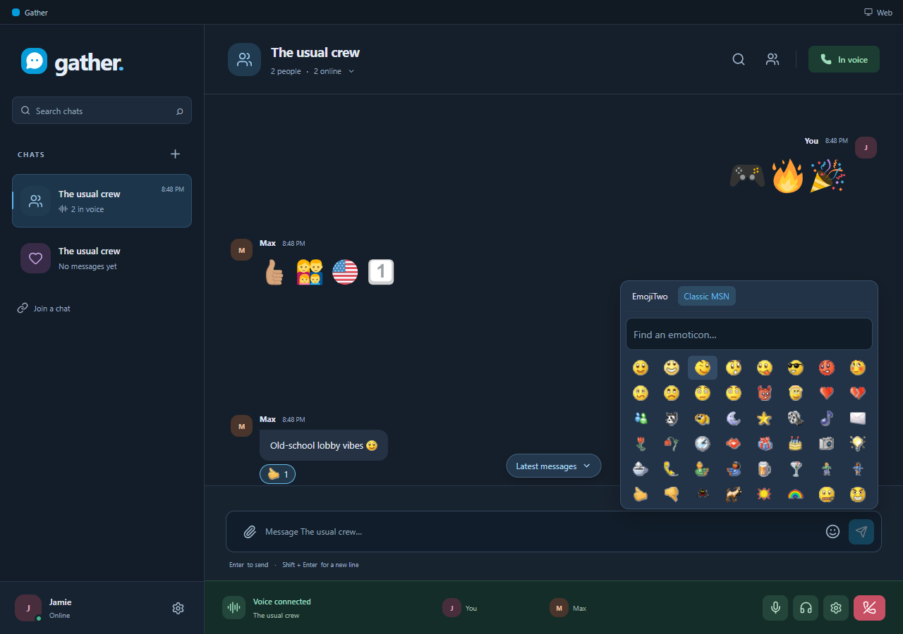

# Gather

 



A free, open-source, Skype/MSN/AIM-inspired place for your small crew. Private group chat and voice for a small group of friends. Windows desktop and browser clients share the same conversations.

[Open Gather](https://gather-friends.max-jacob-hastings.workers.dev/) · [Windows installer](https://gather-friends.max-jacob-hastings.workers.dev/download/windows)

## Use it with friends

1. Enter your name. Open chat details and copy the invite link.
2. Your friend opens the link, enters a name and joins. Chrome and Edge are the tested browsers.
3. Click **Join voice** and allow the microphone. Four people can join a call.

Click the chat name for member controls. One owner can remove people, replace the invite or transfer ownership. Anyone can leave. Removal replaces the old invite and disconnects that member’s call; their received history stays read-only on their device.

The Windows download is a per-user installer. Existing portable users should close their old app and install this version once; the normal Gather profile is reused. Installed Windows builds check for updates quietly, verify Gather's signed metadata and installer bytes, and offer an explicit restart when safe. Active calls and transfers defer updates. Windows publisher signing is not configured, so the first installation can show an unknown-publisher/SmartScreen warning. The portable build remains a manual-update option.

macOS and Linux can use the browser now. Native packaging and synthetic chat/voice tests exist for both Mac architectures and Linux x64; native publisher signing and their update paths remain follow-up work. They are not listed as completed public desktop releases.

## Included in 0.3

- Persistent chat history, per-chat drafts, search-to-message, reading positions, unread markers, export and read-only archive import.
- Ordered offline sending with retry, pause, safe draft replacement and server-reconciled discard.
- Recovery codes and device revocation; encrypted desktop credentials backed by the OS credential service.
- Up to four-person voice, mute/deafen, device selection, speaking indicators and reconnect handling.
- Any nonempty file up to **10,000,000 bytes**, four per message. Inline images/animated GIFs, video and audio where the browser codec supports them; save-original fallback for other formats.
- Full EmojiTwo and classic MSN artwork, local recents, larger emoji-only messages, reactions with participant names, reply/copy, editing/deletion, group rename and uploaded profile/group pictures.
- Clickable HTTP/HTTPS links, basic text formatting and a larger in-app image/GIF viewer.
- Typing indicators, opt-in running-app notifications, per-chat muting, dark/light/system appearance.
- Local file budget, explicitly kept originals, clear/remove controls and durable deletion cleanup.

Use **Settings → History & archives**, **Files on this device**, **Appearance**, or **Updates**. Notifications require the app/tab to be running. A kept file is protected from Gather's automatic cache removal; browser/user clearing or device failure can still remove it. Export important history and save originals elsewhere when you need an independent copy.

The server is a relay, not long-term storage: uploaded files expire 30 days after upload (7 days at 25 MB or more), the oldest sent files roll off at the per-chat and per-person limits, and text is kept at least two years. Devices keep their own copies. One serialized storage authority reserves all private bucket bytes against a **5,000,000,000-byte ceiling**. At the 5 GB ceiling new file admission stops; chat and voice remain separate. Storage capacity is not a cap on all provider request/relay charges. The server can read messages; chat is not end-to-end encrypted. WebRTC encrypts voice transport and no calls are recorded.

## Development and checks

EmojiTwo vectors remain the source artwork in `src/assets/emoji-*.svg`. If refreshing them, rebuild the matching local PNG sheets with `node scripts/build-emoji-atlas.mjs` (uses the test Edge runtime); inventory checks reject missing or duplicate mappings. No runtime image/CDN service is added.

Requires Node 24+. Install dependencies with `npm ci`, then `npm run dev`. `electron/config.json` chooses the backend. An empty server URL starts a loopback Node/SQLite backend; `npm run server` runs it independently.

```sh
npm run build
npm test
npm run dist
npm run test:release
```

`dist` builds Windows installer/portable artifacts and signs update metadata using the ignored local release key. `test:release` exercises unit/server contracts, native/browser persistence, identity/recovery, archives, conversation tools, populated-history interaction measurements, restored-server/client recovery, private media, storage interruption, notifications, offline startup, packaged chat/voice and the portable wrapper. `node scripts/updater-install-smoke.mjs` separately installs and upgrades isolated fixture applications with their own app ID, profile, signing key and loopback feed.

`node scripts/hosted-smoke.mjs http://127.0.0.1:18789` checks a local Wrangler adapter. It can also check an HTTPS deployment; it creates disposable profiles and a separate conversation. `GATHER_HOSTED_RELAY=1` forces relay for that check. Tests use synthetic microphones and actual RTP packets; physical headsets, OS permission prompts and long mixed-network calls still need pilot use.

## Hosting and releases

Cloudflare serves static web assets, a Worker, one SQLite Durable Object and the private R2 media bucket. Voice uses WebRTC with temporary TURN credentials; no LiveKit/media SDK is required. A standalone Node host uses the same domain and SQLite contracts with filesystem object storage.

```sh
npm run cloud:login
npm run cloud:secrets
npm run release:publish
```

Secrets are read from ignored `.env`. The deploy helper uploads only the TURN and operator credentials; backup encryption and update private keys stay local. The release command builds, verifies, prepares chunked static downloads and deploys. A Vite rebuild clears prepared download/update assets: prepare them again before deployment. The public manifest records the installer checksum; `node scripts/check-download.mjs` compares the complete hosted download with the local tested artifact.

Back up before server migrations. [OPERATIONS.md](OPERATIONS.md) covers encrypted snapshots, independent private-repo backup copies, restore, keys and storage accounting. Snapshots include attachment manifests but **not original R2 payloads**; user exports can include locally available originals. No unattended backup schedule is installed. Keep operational encryption keys independently recoverable.

Replies/formatting, link previews, provider GIF search, large peer transfers, cloud expiry and friend-assisted history retrieval are follow-up work. Background painting was cancelled.

## License and credits

Gather's source code is released under the [GNU AGPL-3.0](LICENSE). Bundled third-party artwork is **not** covered by it: emoji art is EmojiTwo (CC BY 4.0) and the classic MSN emoticons are Microsoft artwork redistributed from a community collection without an explicit license. See [licenses/NOTICE.md](licenses/NOTICE.md). Gather is an independent project and is not affiliated with or endorsed by Microsoft, Skype or Discord.

Report security issues privately as described in [SECURITY.md](SECURITY.md).
